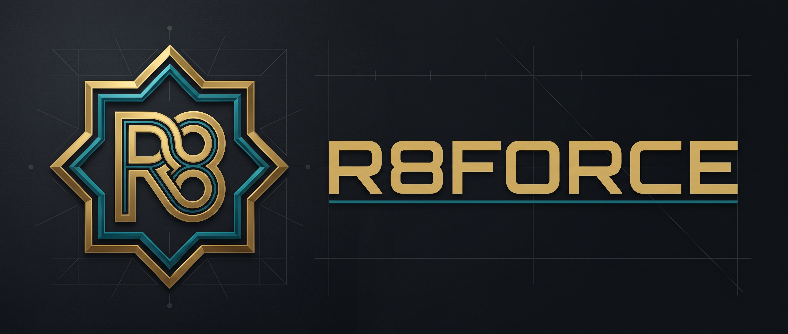

  

# Hi, I'm Amin Shirdeli (R8Force)

Software & Systems Developer exploring the full computing stack — from polished **Android apps & games** down to **C, binary formats, compilers, and x86-64 Assembly**.

---

### Focus Areas

- **Mobile & Interactive Games:** Cross-platform Android apps and 2D games built with Flutter, zero-asset procedural WAV audio synthesis, and automated CI/CD APK builds.
- **Systems & Low-Level Engineering:** C utilities, executable internals (ELF / PE), compiler toolchains, and hardware-level optimization.
- **Reproducible Delivery:** Every public repository is clean, self-contained, and includes automated builds.

---

### Featured R8Force Projects

| Project | Stack | Highlights | Download |
|---|---|---|---|
| [**r8-glass-calculator**](https://github.com/Amin8362/r8-glass-calculator) | Flutter • Dart | Glassmorphic Android calculator with custom parser & 2D/3D geometry | [Latest APK](https://github.com/Amin8362/r8-glass-calculator/releases/latest) |
| [**r8-shoot-cubes**](https://github.com/Amin8362/r8-shoot-cubes) | Flutter • Dart | Shoot & Merge puzzle game with dual math modes & live WAV SFX | [Latest APK](https://github.com/Amin8362/r8-shoot-cubes/releases/latest) |
| [**r8-farm-shop**](https://github.com/Amin8362/r8-farm-shop) | Flutter • Dart | Stage-based farm & shop tycoon with persistent save & auto-workers | [Latest APK](https://github.com/Amin8362/r8-farm-shop/releases/latest) |
| [**r8-bininspect**](https://github.com/Amin8362/r8-bininspect) | C11 | Fast zero-dependency ELF/PE binary analyzer with security checks, entropy & hex viewer | [Linux / Win](https://github.com/Amin8362/r8-bininspect/releases/latest) |
---

### Engineering Roadmap

- [x] Automated Android APK CI/CD pipeline via GitHub Actions
- [x] Mobile apps & games portfolio foundation (`R8Force`)
- [x] Permanent APK distribution via GitHub Releases
- [ ] C & CLI systems utilities (binary/ELF analyzers & fast tools)
- [ ] x86-64 Assembly benchmarks & compiler engineering showcases

---

### معرفی کوتاه (فارسی)

سلام! من **امین شیردلی** (سازنده پروژه‌های **R8Force**) هستم. در این صفحه پروژه‌های کاربردی و آموزشی خودم را در طیف کامل مهندسی نرم‌افزار—از **اپلیکیشن و بازی‌های اندروید** تا **زبان C، ابزارهای سیستمی، کامپایلر و اسمبلی**—به‌صورت متن‌باز و با بیلد خودکار منتشر می‌کنم.

